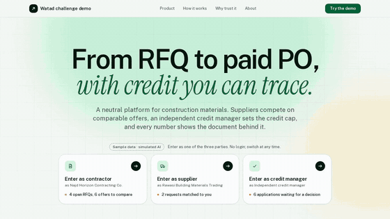
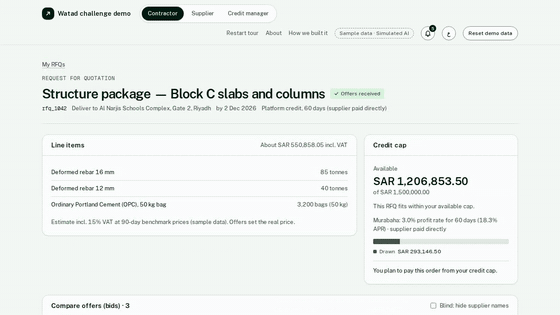
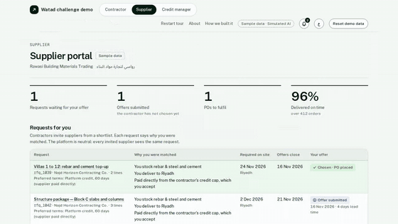
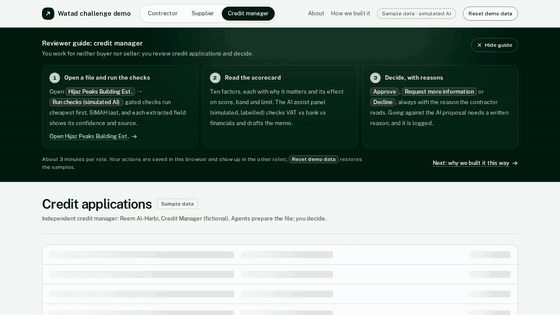
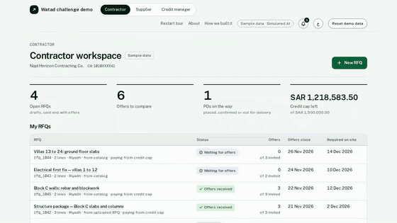

# Watad challenge: construction materials procurement demo

[](https://github.com/malikmmoaz/watad-challenge/actions/workflows/ci.yml?query=branch%3Amain)
[](https://watad-challenge.vercel.app)

A three-role demo for Saudi construction materials procurement: **contractor**, **supplier** and **independent credit manager**, in one app with a role switcher and no login. RFQ → offers → purchase order, with a credit cap drawn per PO and paid to the supplier directly.

All companies, prices and credit files are **sample data**. AI features are **simulated** and labelled where they appear.

**Live: https://watad-challenge.vercel.app** (production, deploys from `main` after every merge).

## For reviewers

**Watch first (about 100 seconds in total).** Each clip is a real run of the app, recorded with Playwright on a production build (sample data, simulated AI labelled). Click a preview for the full-quality MP4.

| Contractor: BOQ to RFQ to explainable shortlist | Contractor: compare offers, pay with credit |
|---|---|
| [](docs/demo/1-contractor-rfq.mp4) | [](docs/demo/2-contractor-po-on-credit.mp4) |
| **Supplier: offer (bid), then fulfil a PO** | **Independent credit manager: checks, scorecard, decision** |
| [](docs/demo/3-supplier-offer-and-po.mp4) | [](docs/demo/4-credit-manager-decision.mp4) |
| **عربي: the same platform in Arabic, right to left** | |
| [](docs/demo/5-arabic-contractor-po.mp4) | |

Re-record after UI changes: `pnpm demo` locally (needs ffmpeg), or Actions → "Demo videos" → Run workflow. Both use a local production build, never the live site.

| | |
|---|---|
| Try it | [5-minute tour](#explore-the-three-roles-in-5-minutes) below · each role also has a **reviewer guide** panel at the top · full path with what to notice: [docs/WALKTHROUGH.md](docs/WALKTHROUGH.md) |
| Arabic | Every screen in Arabic, right to left: press **ع** in the app bar (or on the landing page), **EN** to switch back; remembered in your browser ([ADR 0005](docs/adr/0005-arabic-and-rtl.md)) |
| Why and how | In the app: [About](https://watad-challenge.vercel.app/about) (business model, priorities, stack, use of AI, assumptions, research) · [How we built it](https://watad-challenge.vercel.app/how-we-built) (team of agents, timeline, process) |
| Decisions | [ADR 0001 stack](docs/adr/0001-stack.md) · [0002 procurement ranking](docs/adr/0002-procurement-ranking.md) · [0003 credit assessment](docs/adr/0003-credit-assessment.md) · [0004 browser state and observability](docs/adr/0004-browser-state-and-observability.md) · [0005 Arabic and RTL](docs/adr/0005-arabic-and-rtl.md) · [0006 tax invoice and ZATCA QR](docs/adr/0006-tax-invoice-zatca-qr.md) |
| Quality | Every PR needs green **verify** (lint, types, unit tests, build), **e2e** (Playwright on desktop and phone, in English and Arabic, axe WCAG 2.2 AA, keyboard-only journeys) and **Lighthouse** budgets, plus a recorded review · [brief checklist](docs/BRIEF-CHECKLIST.md) · [incidents and how we handled them](docs/incidents.md) |
| Analytics and uptime | Anonymous, typed events and funnels: [public analytics dashboard](https://eu.posthog.com/shared/_TVLZSISE6RiSWDUmfTJWdm8ST-Fjw) · [docs/analytics.md](docs/analytics.md) · [live status page](https://watad-challenge-demo.betteruptime.com) (Better Stack, checked every 3 minutes) |
| Work log | [Issues](https://github.com/malikmmoaz/watad-challenge/issues?q=is%3Aissue) · [Pull requests](https://github.com/malikmmoaz/watad-challenge/pulls?q=is%3Apr) · [CHANGELOG](CHANGELOG.md) · [PLAN](PLAN.md) · [handoff notes](docs/handoff/) |

## Explore the three roles in 5 minutes

Open **https://watad-challenge.vercel.app**. No login: pick a role on the landing page, and switch at any time from the bar at the top. Everything you do is saved in your browser, so an action in one role shows up in the others. **Reset demo data** (top bar) restores the samples.

**1. Contractor (about 2 minutes), as Najd Horizon Contracting Co.**
- **New RFQ**: upload a BOQ (or **Try the sample BOQ**) and watch the simulated BOQ reader fill editable line items, or pick from the catalog. Confirm quantities, site and date.
- **Choose suppliers**: the shortlist explains why each distributor is in or out, and whether the order fits your credit cap.
- Open **Structure package — Block C** (`rfq_1042`): compare 3 offers on landed cost incl. 15% VAT, lead time, terms and reliability, then **Choose offer** and place the purchase order, **paying with credit**. The supplier is paid directly; you see the Murabaha markup, APR and due date.
- **Credit cap, applications and progress**: the cap, the draws on it, **Repay**, and **Apply for a higher cap** with the Saudi document set.

**2. Supplier (about 1 minute), as Rawasi Building Materials Trading**
- The inbox shows only requests you were matched to, with why. Open **Villas 13 to 24** (`rfq_1044`) and **Submit offer**: price, stock, lead time, payment terms, local content.
- Awarded orders: move the PO through accepted, dispatched and invoiced.

**3. Credit manager (about 2 minutes), independent of buyer and seller**
- **Credit applications**: the queue. Open **Hijaz Peaks Building Est.** (`cc_502`): gated checks (CR, VAT, bank, financials, SIMAH last), extracted fields with the page they came from, the scorecard with top factors, and the simulated AI credit memo.
- **Record decision**: approve, request more information or decline, with reasons. The contractor sees the outcome on their credit page.

Then read **About** and **How we built it** (top bar). The full reviewer path, with what to notice at each step, is in [docs/WALKTHROUGH.md](docs/WALKTHROUGH.md).

## Run

```bash
pnpm install
pnpm dev        # http://localhost:3100
```

On the team machine, start every command with `. ~/watad-team/env.sh` and use ports 3100–3199 only.

## Check

```bash
pnpm lint
pnpm typecheck
pnpm test       # Vitest unit tests
pnpm build
pnpm e2e        # Playwright: smoke, journeys, axe a11y, keyboard, headers (builds and serves on :3110)
```

CI (`.github/workflows/ci.yml`) runs three required checks on every PR and on `main`: **verify** (the first four), **e2e**, and **lighthouse** (budgets in `lighthouserc.cjs` on `/` and `/contractor`).

## Structure

```
src/app/            landing page with role switcher
src/app/contractor  contractor area
src/app/supplier    supplier area
src/app/credit      credit manager area
src/domain          shared types (frozen), money helpers, pure logic + tests
src/data            seeded sample data
src/store           browser demo store (useDemo, update, resetDemo)
src/components      shared UI
docs/adr            lasting decisions
docs/handoff        per-agent handoff notes
docs/incidents.md   what went wrong while building and how we handled it
```

## Working agreement

Every task is a GitHub issue. Branch `feat/<issue>-name`, small PRs, conventional commits, green CI and one approving review before merge; nobody pushes to main. Shared types change only through a PR labelled `types`. See `PLAN.md` for status and `docs/adr/0001-stack.md` for the architecture.

## Deploy

Vercel, imported by Malik through Vercel's GitHub integration (limited to this repo). Agents hold no Vercel credentials: there is no Vercel CLI on the team machine and no `vercel.json`.

- `main` deploys to production; every PR gets a preview deployment.
- Default Next.js settings: build `next build`, install `pnpm install`. Vercel picks pnpm 10 from the lockfile (`lockfileVersion: '9.0'`); install and build with pnpm 10 are verified. Node is pinned to `22.x` in `package.json`, matching CI.
- Deployment status and URLs: the PR checks, the Vercel bot comment, or `gh api repos/malikmmoaz/watad-challenge/deployments`.
- The app runs with no environment variables. Optional: `NEXT_PUBLIC_POSTHOG_KEY` turns on product analytics (see `.env.example` and `docs/analytics.md`).
